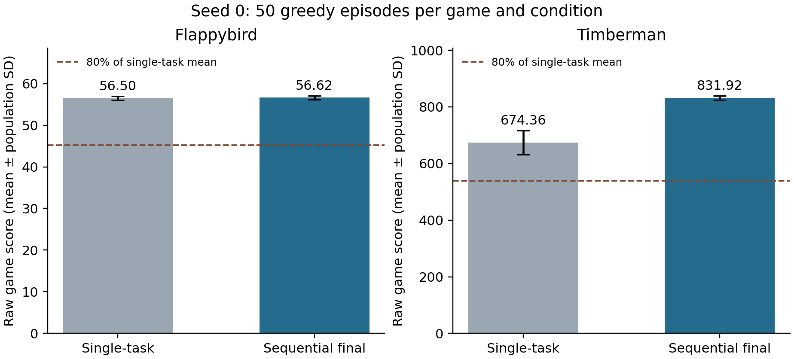
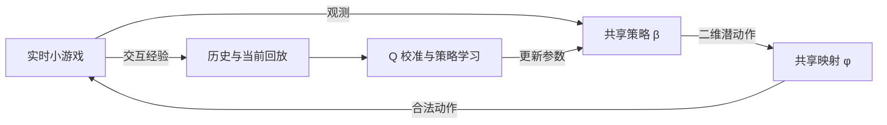

# MT-Cal-LAICA-v3

以 WemiEnv 为实时小游戏平台，将连续 Cal-LAICA 适配到 Flappybird 和 Timberman。一个共享模型先学习 Flappybird，再恢复同一个 checkpoint 学习 Timberman，最终同实例评测两个游戏。

| seed-0 greedy 评测，每游戏 50 局 | 单任务均分 | 最终模型均分 | 达标局数 |
| --- | ---: | ---: | ---: |
| Flappybird | 56.50 | 56.62 | 50/50 |
| Timberman | 674.36 | 831.92 | 50/50 |

训练 Timberman 前，Flappybird 的均分为 56.38。本次未观察到旧游戏能力下降。最终 100 局均达到每局 1000 步上限；更多随机种子和机制消融仍待验证。



图中误差线为局间总体标准差，不是跨种子的置信区间。数据见 [results/seed0](results/seed0)。

## 模型与训练

模型共享连续策略 β、逆动力学 ψ、动作映射 φ 和双 Q。29 维结构化观测包含游戏标识；模型通过动作掩码选择当前游戏的合法动作。



Timberman 阶段每次更新使用 Flappybird 历史 64 条和 Timberman 在线 64 条。Q 校准使用轨迹参考回报。初始离线训练只执行一次，format-3 checkpoint 连同优化器、回放和随机数状态一起恢复。

## 快速核验

只核对公开的历史结果，无需安装 PyTorch 或启动微信客户端：

```bash
python scripts/verify_results.py
```

若已下载发布的 checkpoint，可一并检查文件哈希：

```bash
python scripts/verify_results.py --checkpoint models/stage_Timberman.pt
```

最终文件的 SHA-256 为 `143d08ec214888b9e99370514ba3ed872b3ea692b39835420df9820f6b4f61ae`。

## 复现

完整步骤见 [复现指南](docs/reproduction.md)。源码基于实现提交 `25ca3b6d6d0e8ec8c288de0be4cc5467cdb5ab3c`，上游平台固定为 `5970399a0e8f1c29ed2da5b453606a323136882d`。

组会介绍见 [项目记录](docs/project-note.md)，发布前的检查见 [验证记录](docs/publication-validation.md)。

```bash
conda create -n mt-cal-laica python=3.10.21 -y
conda activate mt-cal-laica
python -m pip install -r requirements.txt

git clone https://github.com/Ada9io/WemiEnv.git external/WemiEnv
git -C external/WemiEnv checkout 5970399a0e8f1c29ed2da5b453606a323136882d
python scripts/prepare_runtime.py --upstream external/WemiEnv

export PYTHONDONTWRITEBYTECODE=1
python -m pytest wemi_cal/tests -q -p no:cacheprovider
node wemi_cal/tests/js/test_envcore.js
```

运行时准备脚本不启动训练，并拒绝覆盖已有目录。第三方平台和游戏从上游本地准备，参见 [来源与许可](THIRD_PARTY_NOTICES.md)。

实验包装器可以先输出实际命令供检查：

```bash
python scripts/experiment.py strict-t --seed 0 --dry-run
```

真实实验需要微信开发者工具。先启动 Python，等待 7911 监听后，再打开对应 realtime 客户端。每个新进程只编译一次；最终双游戏评测在 F 完成后保留 Python 进程，切换到 T 客户端。

## 文件

| 目录 | 内容 |
| --- | --- |
| `wemi_cal/` | 模型、表示适配、校准、回放、训练与评测 |
| `scripts/` | 运行时准备、实验命令包装、历史结果核验 |
| `results/seed0/` | 单任务基线、最终结果和完整 100 局审计 |
| `tests/runtime-fixtures/` | fake 协议测试所需的适配模块 |
| `docs/` | 复现指南和组会项目记录 |

原始完整 checkpoint、日志和论文保留在本地归档中；最终 checkpoint 通过 GitHub Release 提供。上游游戏不会等待 agent，通信延迟和客户端版本属于真实实验条件。

## 研究来源

- [WemiEnv](https://github.com/Ada9io/WemiEnv)：交互平台。
- *Calibrated Lifelong Reinforcement Learning for Efficient Adaptation to Changing Action Sets*，以及 [Cal-LAICA 实验仓库](https://github.com/bailei951/Cal-LAICA-Experiments)：算法思想。
- 本项目在已知任务条件下验证跨游戏连续学习；论文的原始实验研究迷宫中的动作集合扩张。固定 64/64 回放和映射概率校正属于本项目适配。
